<p align="center">
  
</p>

# 🚀 Awesome Org Configuration Optimization [](https://awesome.re)

> 🔍 **A curated list of top SaaS products, enterprise platforms, and open-source GitHub projects for SaaS & Salesforce org configuration optimization, technical debt reduction, metadata analysis, configuration drift monitoring, and org health intelligence.**

[](#table-of-contents)
[](https://makeapullrequest.com)
[](LICENSE)
[](https://github.com/ishandutta2007/Awesome-Org-Configuration-Optimization)

---

## 📌 Executive Summary & Key Highlights

Modern enterprise SaaS platforms (notably Salesforce, ServiceNow, and Dynamics 365) accumulate vast volumes of metadata debt over time: obsolete Apex triggers, circular automation flows, unreferenced custom fields, bloated permission sets, and divergent sandbox configurations. 

This repository tracks the leading **SaaS platforms** and **open-source developer tools** designed to:
- 🧹 **Identify Technical Debt & Unused Metadata**: Discover unused custom fields, unreferenced Apex classes, stale validation rules, and dead automations.
- 🔄 **Detect & Remediate Configuration Drift**: Continuously audit disparities between staging, sandboxes, and production environments.
- ⚡ **Optimize Execution Architecture**: Prepare enterprise orgs for agentic workflows (like Agentforce), high-throughput data volumes, and clean CI/CD release pipelines.
- 🛡️ **Enforce Security & Compliance**: Run automated code governance, profile drift audits, and Well-Architected health checks.

---

## 📑 Table of Contents

- [📊 Sector Overview & Market Dynamics](#-sector-overview--market-dynamics)
- [🏢 SaaS & Hosted Platforms](#-saas--hosted-platforms)
- [💻 Open-Source GitHub Projects](#-open-source-github-projects)
- [🛠️ Architecture: Custom Self-Hosted Org Optimization Stack](#-architecture-custom-self-hosted-org-optimization-stack)
- [🤝 How to Contribute](#-how-to-contribute)
- [⚖️ Disclaimer](#-disclaimer)

---

## 📊 Sector Overview & Market Dynamics

The **Salesforce DevOps, Metadata Intelligence, and Org Health Optimization** software market is estimated at **$250 million to $350 million annually**, acting as the catalyst for an adjacent **$5+ billion enterprise DevOps consulting and systems integration services market** (within the multi-trillion dollar broader Salesforce Economy forecasted by IDC). 

The sector is **moderately fragmented**: while foundational platform CRM dominance is heavily concentrated (Salesforce holding over 20% global market share), the metadata optimization and configuration intelligence layer remains dynamic. Category specialists focus on targeted niches—such as deep CPQ/data migration (Prodly), code governance and static analysis (Quality Clouds, Clayton), change impact visualization (Elements.cloud, Panaya), and git-backed configuration-as-code (Salto)—while open-source utilities provide data-sovereign audits for cost-conscious architects.

---

## 🏢 SaaS & Hosted Platforms

The table below catalogs the premier commercial platforms for Salesforce and SaaS org configuration optimization. 

Entries are sorted in descending order by **Company Valuation / Revenue / Scale**.

| 🏢 Product & Platform | 💰 Specific Pricing Model | 🎁 Free Tier / Free Trial Limits | 📈 Company Scale (Valuation / Revenue) | 🎯 Core Focus & Capabilities |
| :--- | :--- | :--- | :--- | :--- |
| **[Salesforce Optimizer](https://help.salesforce.com/)** | **Included ($0 additional)** with Salesforce Enterprise ($165/user/mo) & Unlimited ($330/user/mo) editions | **Native feature** for active Salesforce orgs; 50+ metric scans per execution | **$34.8B+ FY24 Revenue** (Market Cap ~$300B+) | Built-in snapshot engine analyzing 50+ org health metrics across storage, security, custom fields, and limits. *(Note: Transitioning focus to Org Check & Well-Architected tools)*. |
| **[Panaya ForeSight](https://www.panaya.com/)** | **Starts at $14,750 / year** (ForeSight Basic tier for ~3 named users) | **14-day free trial**; scoping assessment with sample org impact extraction | **$200M Acquisition Valuation** (Subsidiary of Infosys, ~$20M-$50M ARR) | Enterprise Change Intelligence and Smart Impact Engine mapping cross-metadata dependencies across Salesforce, CPQ, and ERP environments. |
| **[Salto](https://www.salto.io/)** | **Starts at $417 / month** (~$5,000 / year base, scaling by configuration size) | **14-day free trial** (Full feature access; free instances retired in late 2025) | **$69M Total Venture Funding** (Series B $42M led by Accel / Bessemer) | Configuration-as-Code (IaC) and drift management extracting, diffing, and deploying metadata across business applications with Git integration. |
| **[Prodly](https://www.prodly.com/)** | **Starts at $1,500 / month** ($18,000 / year entry deployment package) | **14-day sandbox trial**; guided demo org assessment | **$21.9M Total Venture Funding** (~$3M-$5M ARR, Series A led by Leta Capital) | Low-code DevOps, CPQ seed-data migration, and org configuration versioning across multi-tier sandbox pipelines. |
| **[Elements.cloud](https://elements.cloud/)** | **Starts at $6,800 / year** (Core Metadata tier based on org seat count) | **Free forever tier** for unlimited process mapping & diagramming; 14-day metadata trial | **$20M Total Funding** (~$3.1M ARR, backed by growth investors) | Salesforce Change Intelligence platform delivering end-to-end dependency mapping, metadata dictionary, and AI-assisted impact analysis. |
| **[Quality Clouds](https://qualityclouds.ai/)** | **Starts at $199 / month** (Norma tier) or ~$6,000 / year per monitored instance | **Free forever plan** for Norma (1 dev, 1 repo, limited scans); 14-day enterprise trial | **~$9M - $11.1M Annual Revenue** (Backed by YFM Equity Partners) | Multi-SaaS static code analysis and governance platform for Salesforce and ServiceNow tracking technical debt and CI/CD quality gates. |
| **[Hubbl Diagnostics](https://www.hubbl.com/)** | **Starts at $5,000 / year** per monitored Salesforce organization | **Free tier available**: 1 basic subset scan every 30 days per org | **$6M Series A Venture Funding** (High-growth private intelligence startup) | Automated org health audits, complexity indexing, license utilization, and AI recommendation dashboards aligned with Salesforce Well-Architected. |
| **[Clayton.io](https://clayton.io/)** | **Starts at $20 / seat / month** (Basic) and **$30 / seat / month** (Pro) | **Free forever plan**: Up to 5 team members, 2 Claytons, 20 AI code reviews / month | **Bootstrapped / High-Efficiency** (Specialist Salesforce DevSecOps scale) | AI-powered code review and DevSecOps governance platform tailored specifically for Apex, LWC, and Salesforce architecture security. |
| **[Metazoa Snapshot](https://www.metazoa.com/)** | **Starts at $2,950 / year** (Consultant license; enterprise scaled by active users) | **14-day full feature trial** (Includes sample cleanup and impact reports) | **Bootstrapped Market Leader** (Longstanding premier AppExchange partner) | Comprehensive metadata management suite featuring impact reports for 250+ metadata types, unused asset purging, and org merging/splitting. |

---

## 💻 Open-Source GitHub Projects

Open-source utilities empower Salesforce administrators, security engineers, and DevOps architects to build transparent, cost-effective, and fully data-sovereign org analysis workflows.

The repositories below are sorted in descending order by **GitHub Star Count**. Each badge links directly to that repository's stargazers community.

| 💻 Repository & Community | ⭐ GitHub Stars | ⚖️ License | 🛠️ Primary Tech Stack | 📖 Description & Optimization Role |
| :--- | :--- | :--- | :--- | :--- |
| **[Apache Superset](https://github.com/apache/superset)** | [](https://github.com/apache/superset/stargazers) | Apache-2.0 | Python / TypeScript | Enterprise-grade business intelligence and dashboard platform; ideal for building long-term org health trends, field usage metrics, and historical metadata drift visualizations. |
| **[Ansible](https://github.com/ansible/ansible)** | [](https://github.com/ansible/ansible/stargazers) | GPL-3.0 | Python | Ubiquitous declarative configuration automation engine; utilized alongside integrations like `ansible-inspec` for multi-cloud configuration auditing and compliance workflows. |
| **[Metabase](https://github.com/metabase/metabase)** | [](https://github.com/metabase/metabase/stargazers) | AGPL-3.0 | Clojure / JavaScript | The fastest, open-source BI interface to explore Salesforce data extracts, Org Check audit tables, and technical debt KPIs without SQL complexity. |
| **[Apache Airflow](https://github.com/apache/airflow)** | [](https://github.com/apache/airflow/stargazers) | Apache-2.0 | Python | Distributed workflow orchestration engine commonly deployed to schedule automated nightly org health snapshots, metadata backups, and multi-org drift reconciliations. |
| **[Dagster](https://github.com/dagster-io/dagster)** | [](https://github.com/dagster-io/dagster/stargazers) | Apache-2.0 | Python | Cloud-native data orchestrator designed for asset-based pipelines, perfect for managing Salesforce schema extraction, transformations, and governance audits. |
| **[PMD](https://github.com/pmd/pmd)** | [](https://github.com/pmd/pmd/stargazers) | BSD-Style | Java | Highly extensible multilingual static code analyzer with deep support for Apex and Visualforce, catching bad trigger design, security flaws, and performance anti-patterns. |
| **[InSpec](https://github.com/inspec/inspec)** | [](https://github.com/inspec/inspec/stargazers) | Chef EULA / Apache-2.0 | Ruby | Automated security specification and compliance auditing framework used to turn infrastructure and SaaS security policies into testable code. |
| **[Apex Common (fflib)](https://github.com/financialforcedev/fflib-apex-common)** | [](https://github.com/financialforcedev/fflib-apex-common/stargazers) | BSD-3-Clause | Apex | The gold standard enterprise Apex enterprise pattern library (Service, Domain, Selector, Unit of Work) that prevents architectural debt and standardizes org customization. |
| **[DLRS (Declarative Lookup Rollup Summaries)](https://github.com/afawcett/declarative-lookup-rollup-summaries)** | [](https://github.com/afawcett/declarative-lookup-rollup-summaries/stargazers) | BSD-3-Clause | Apex | Replaces custom Apex triggers and bulky Record-Triggered Flows with clean declarative rollup logic across lookup relationships, directly slashing org automation complexity. |
| **[Operately](https://github.com/Operately/Operately)** | [](https://github.com/Operately/Operately/stargazers) | Apache-2.0 | Elixir / Rust | Open-source company operations and governance system delivering project alignment, operational cadence, and change accountability across organizational teams. |
| **[Salesforce CLI (`sf`)](https://github.com/forcedotcom/cli)** | [](https://github.com/forcedotcom/cli/stargazers) | BSD-3-Clause | TypeScript | The official CLI unifying metadata retrieval, source tracking, schema inspection, org scratch creation, and automated CI/CD deployments. |
| **[SFDMU (SFDX Data Move Utility)](https://github.com/forcedotcom/SFDX-Data-Move-Utility)** | [](https://github.com/forcedotcom/SFDX-Data-Move-Utility/stargazers) | MIT | TypeScript | Innovative, metadata-aware tool for seeding, migrating, and scrubbing relational Salesforce data between developer scratch orgs and production environments. |
| **[sfdx-hardis](https://github.com/hardisgroupcom/sfdx-hardis)** | [](https://github.com/hardisgroupcom/sfdx-hardis/stargazers) | MIT | TypeScript | Complete open-source Salesforce DevOps framework equipped with built-in org audit reports, code coverage heatmaps, and automated technical debt diagnostics. |
| **[CumulusCI](https://github.com/SFDO-Tooling/CumulusCI)** | [](https://github.com/SFDO-Tooling/CumulusCI/stargazers) | BSD-3-Clause | Python | Powerful Salesforce DevOps automation framework originally engineered by Salesforce.org for portable metadata recipes, org builds, and multi-package testing. |
| **[SFDX Scanner](https://github.com/forcedotcom/sfdx-scanner)** | [](https://github.com/forcedotcom/sfdx-scanner?style=social&color=white)](https://github.com/forcedotcom/sfdx-scanner/stargazers) | BSD-3-Clause | TypeScript | Official unified Salesforce Code Analyzer integrating PMD, ESLint, RetireJS, and Salesforce Graph Engine to identify dead paths and security vulnerabilities. |
| **[Org Check](https://github.com/SalesforceLabs/OrgCheck)** | [](https://github.com/SalesforceLabs/OrgCheck/stargazers) | Apache-2.0 | JavaScript / Apex | Flagship Salesforce Labs open-source application and `sf` plugin that evaluates custom code, unused fields, role hierarchies, and flows, exporting full findings to JSON/CSV. |
| **[Tailor](https://github.com/opendevstack/tailor)** | [](https://github.com/opendevstack/tailor/stargazers) | BSD-3-Clause | Go | Declarative configuration management tool for template drift detection; displays side-by-side differential state before applying structural configuration adjustments. |
| **[Salesforce MCP Server](https://github.com/SameerShrivastava-SF/Salesforce-MCP-Server)** | [](https://github.com/SameerShrivastava-SF/Salesforce-MCP-Server/stargazers) | MIT | Python | High-performance Model Context Protocol (MCP) server for deep Salesforce field usage analysis across 8+ metadata layers, accelerating AI agent audits by 5x-6x. |

---

## 🛠️ Architecture: Custom Self-Hosted Org Optimization Stack

For engineering teams seeking total data sovereignty without recurrent per-user SaaS fees, you can assemble a complete enterprise-grade org monitoring stack using the open-source projects featured above:

```
┌────────────────────────────────────────────────────────────────────────┐
│                   ENTERPRISE SALESFORCE ORG(S)                        │
└───────────────┬────────────────────────────────────────┬───────────────┘
                │ Metadata & Schema Extraction           │ Data & Audit Logs
                ▼                                        ▼
┌───────────────────────────────────┐    ┌───────────────────────────────┐
│        COLLECTION & AUDIT         │    │      DATA & MIGRATION         │
│  • Org Check (Metadata Debt)      │    │  • SFDMU (Seed & Sync)        │
│  • SFDX Scanner (Code Health)     │    │  • Salesforce CLI             │
│  • Salesforce-MCP-Server (Fields) │    │  • Tailor (Drift Control)     │
└─────────────────┬─────────────────┘    └───────────────┬───────────────┘
                  │                                      │
                  ▼                                      ▼
┌────────────────────────────────────────────────────────────────────────┐
│                      PIPELINE & ORCHESTRATION                          │
│               • Apache Airflow / Dagster (Scheduled Jobs)              │
│               • CumulusCI / sfdx-hardis (DevOps CI/CD)                 │
└───────────────────────────────────┬────────────────────────────────────┘
                                    │ Aggregated Health Metrics
                                    ▼
┌────────────────────────────────────────────────────────────────────────┐
│                   ANALYTICS & STAKEHOLDER PORTAL                       │
│               • Metabase / Apache Superset Dashboards                  │
│               • Operately (Organizational Governance & OKRs)           │
└────────────────────────────────────────────────────────────────────────┘
```

1. **Extraction & Auditing**: Run **[Org Check](https://github.com/SalesforceLabs/OrgCheck)** and **[SFDX Scanner](https://github.com/forcedotcom/sfdx-scanner)** via CLI inside headless pipelines to scan Apex, Flows, and unused fields.
2. **Field & Relationship Profiling**: Leverage **[Salesforce-MCP-Server](https://github.com/SameerShrivastava-SF/Salesforce-MCP-Server)** to generate granular metadata dependency graphs.
3. **Drift Detection**: Use **[Tailor](https://github.com/opendevstack/tailor)** and **[sfdx-hardis](https://github.com/hardisgroupcom/sfdx-hardis)** to monitor configuration delta between environments.
4. **Scheduled Orchestration**: Coordinate nightly diagnostic extraction using **[Apache Airflow](https://github.com/apache/airflow)** or **[Dagster](https://github.com/dagster-io/dagster)**.
5. **Executive Visibility**: Push summary metrics to PostgreSQL and visualize debt remediation trajectories in **[Metabase](https://github.com/metabase/metabase)** or **[Apache Superset](https://github.com/apache/superset)**.

---

## 🤝 How to Contribute

We welcome contributions from administrators, architects, developers, and platform teams worldwide!

1. 🍴 **Fork the repository** on GitHub.
2. 🌿 **Create a new branch**: `git checkout -b feature/add-new-tool`
3. 📝 **Add or update entries**: Ensure SaaS pricing, free tier limits, company scale, and open-source star badges follow existing formatting guidelines.
4. 📬 **Submit a Pull Request** with a concise description of why the tool provides value to org configuration optimization.

---

## ⚖️ Disclaimer

- This is a **community-curated, independent directory** — listed tools do not constitute an official endorsement by Salesforce, Inc.
- All org optimization, metadata extraction, and remediation tooling should be tested in isolated sandbox environments prior to production execution.
- Review compliance requirements (e.g., GDPR, CCPA, SOC 2, HIPAA) when connecting third-party or self-hosted tools to enterprise SaaS environments.

---

<p align="center">
  <b>Built with ❤️ for Salesforce Admins, Architects, DevOps Teams &amp; Platform Engineers worldwide.</b><br>
  <i>Found this helpful? Don't forget to star ⭐ this repository!</i>
</p>
